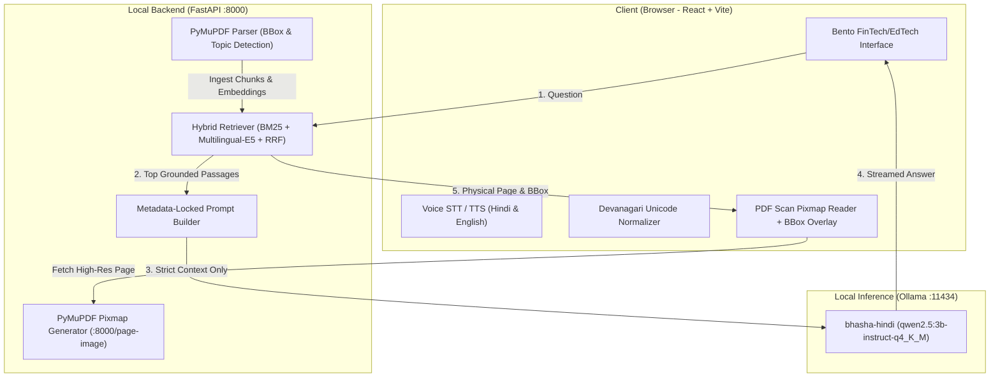

# 📖 Bhasha Mentor (भाषा मेंटर)

> **100% Offline, CPU-Only Multilingual AI Study Assistant with Metadata-Locked Textbook Grounding**  
> *Built for Track 5: Open Source for Bharat · Devf8rge Hacktoberfest Hack Day*  
> **Team FunctionalX:** Tanishq Naik · Shriyansh Narvekar · Priyal Nagvekar

---

[](https://github.com/Functionalloop/bhasha-mentor)
[-blue?style=for-the-badge)](https://github.com/Functionalloop/bhasha-mentor)
[](https://github.com/Functionalloop/bhasha-mentor)
[](https://github.com/Functionalloop/bhasha-mentor)
[](LICENSE)

---

## 🎯 Problem Statement

Millions of students across Bharat study STEM and humanities subjects in regional languages (Hindi, Marathi, Bengali, Tamil, etc.) using government-issued textbooks (NCERT / State Boards). These students face severe technological barriers:

1. **Unreliable Connectivity:** Rural and suburban schools often operate with intermittent or zero internet access.
2. **LLM Hallucinations:** Commercial AI chatbots frequently hallucinate page numbers, formulas, and textbook citations, misleading students during exam preparation.
3. **Corrupted Devanagari PDF Text:** Legacy NCERT PDFs contain broken font encodings, reversed pre-base matras (e.g., `ि`), disconnected conjunct consonants, and phantom dotted circles (`◌`), causing standard OCR/parsers to produce garbled text.
4. **Cloud & GPU Dependency:** Most modern RAG frameworks require paid cloud APIs or expensive multi-gigabyte GPU VRAM, making them inaccessible on entry-level student laptops.

---

## 💡 The Solution: Bhasha Mentor

**Bhasha Mentor** is an autonomous, fully local, offline AI textbook tutor designed to run smoothly on an entry-level laptop (8 GB RAM, integrated CPU graphics, zero GPU). 

Students can ask questions via voice or text in any of 18 languages, and receive accurate answers strictly grounded in their textbooks—accompanied by an authentic **PDF page scan with an exact visual bounding-box highlight** showing precisely where the answer came from.

### 🌟 Key Features

- **🔒 100% Offline at Runtime:** Runs without Wi-Fi or cellular data. All inference, retrieval, and UI rendering execute locally via FastAPI and Ollama (`HF_HUB_OFFLINE=1`).
- **🎯 Metadata-Locked Citations:** Page numbers and chapter headings are extracted directly from PDF structure via PyMuPDF during ingestion. The LLM is never prompted to generate or guess page numbers—preventing citation hallucination by design.
- **📄 Authentic PDF Scan Reader:** Renders high-resolution PDF page scans directly with interactive zoom controls and crisp Electric Lime (`#C8FF00`) bounding-box overlays.
- **⚡ Hybrid Dense + Sparse Retrieval:** Combines Devanagari-aware tokenized **Rank-BM25** with local **`intfloat/multilingual-e5-small`** vector embeddings fused via **Reciprocal Rank Fusion (RRF, k=60)**.
- **🛠️ Devanagari Unicode Normalization Engine:** Auto-repairs corrupted NCERT font sequences, pre-base matra inversions (`\u093F`), stray whitespace in half-consonants, and removes phantom dotted circles (`\u25CC`).
- **📐 LaTeX Math Formatter:** Cleans unformatted LaTeX syntax (e.g., `\Delta Q = \Delta U + \Delta W`) into clean, readable scientific notation.
- **🎙️ Voice Speech-to-Text & Text-to-Speech:** Integrated Hindi (`hi-IN`) and English (`en-IN`) microphone speech recognition and natural local voice synthesis.
- **🌐 18 Languages Supported:** Hindi, Marathi, Bengali, Tamil, Telugu, Gujarati, Kannada, Malayalam, Odia, Punjabi, Urdu, Sanskrit, English, French, German, Spanish, Japanese, and Russian.
- **📂 Dynamic Custom PDF Ingestion:** Upload any PDF textbook directly in the browser; automatic chapter detection, semantic chunking, and embedding cache creation.
- **🎨 Editorial Bento Workspace:** Ultra-clean, modern high-contrast interface inspired by modern fintech/edtech aesthetics with zero emojis and responsive typography.

---

## 🏗️ System Architecture



---

## 📋 Prerequisites & Hardware Requirements

- **Operating System:** Windows 10/11, Ubuntu 20.04+, or macOS
- **RAM:** 8 GB minimum (runs comfortably on CPU)
- **Disk Space:** ~5 GB free (for Ollama model & embedding weights)
- **Software:**
  - Python 3.10+ (tested on Python 3.10, 3.11, 3.13)
  - Node.js 18+ and npm
  - [Ollama](https://ollama.com/) installed locally

---

## 🚀 Quick Start Guide

### Step 1: One-Time Online Setup (While Internet is Connected)

```bash
# 1. Clone repository
git clone https://github.com/Functionalloop/bhasha-mentor.git
cd bhasha-mentor

# 2. Setup Python virtual environment
python -m venv venv
# Windows:
venv\Scripts\activate
# Linux/macOS:
source venv/bin/activate

# 3. Install backend dependencies
pip install -r backend/requirements.txt

# 4. Download local embedding model (~130 MB)
python backend/download_models.py

# 5. Pull and build the local LLM in Ollama
ollama pull qwen2.5:3b-instruct-q4_K_M
ollama create bhasha-hindi -f backend/Modelfile

# 6. Install frontend packages and build production bundle
cd frontend
npm install
npm run build
cd ..
```

### Step 2: Running 100% Offline (Turn Wi-Fi OFF!)

Once the models and dependencies are downloaded, **disconnect your Wi-Fi or network cable**.

#### Option A: Windows Batch Launcher (One-Click)
Double-click `start_backend.bat` or run:
```cmd
start_backend.bat
```

#### Option B: Terminal Commands
1. **Ensure Ollama is running:**
   ```bash
   ollama serve
   ```

2. **Start the FastAPI Backend:**
   ```bash
   # Windows:
   venv\Scripts\activate
   python -m uvicorn backend.main:app --port 8000 --host 0.0.0.0

   # Linux/macOS:
   source venv/bin/activate
   python -m uvicorn backend.main:app --port 8000 --host 0.0.0.0
   ```

3. **Start Frontend (Development or Production):**
   ```bash
   # For live development with hot-reload:
   cd frontend
   npm run dev
   # Open http://localhost:5173

   # Or access the backend-hosted built UI at:
   # http://localhost:8000
   ```

---

## 🧪 Verification & Benchmark Suite

Verify that retrieval and page citations are 100% accurate on NCERT Class 11 Physics Chapter 12 (*ऊष्मागतिकी - Thermodynamics*):

```bash
python evaluate_tkd.py
```

### Sample Benchmark Questions & Ground Truth

| # | Question (Hindi) | Expected PDF Page | Key Grounded Concept |
|---|---|:---:|---|
| 1 | ऊष्मागतिकी का शून्य कोटि नियम क्या कहता है और इससे किस भौतिक राशि की अवधारणा विकसित होती है? | **Page 3** | तापीय साम्यावस्था एवं तापमान (Zeroth Law & Temperature) |
| 2 | आंतरिक ऊर्जा को ऊष्मागतिकीय 'अवस्था चर' क्यों कहा जाता है? | **Page 4** | आंतरिक ऊर्जा एवं अवस्था चर (Internal Energy State Variable) |
| 3 | ऊष्मागतिकी के प्रथम नियम का गणितीय समीकरण लिखिए और उसमें ΔQ, ΔU तथा ΔW का अर्थ बताइए। | **Page 5** | प्रथम नियम समीकरण: $\Delta Q = \Delta U + \Delta W$ |
| 4 | वायुमंडलीय दाब पर 1 ग्राम जल के वाष्प में बदलने पर उसकी आंतरिक ऊर्जा में कितना परिवर्तन होता है? | **Page 6** | जल-वाष्पन आंतरिक ऊर्जा गणना (2082.4 J) |
| 5 | कार्नो इंजन की दक्षता का सूत्र क्या है, और यह किन राशियों पर निर्भर करती है? | **Page 15** | कार्नो दक्षता: $\eta = 1 - T_2 / T_1$ |

Run preflight health check before demos:
```bash
python backend/preflight.py
```

---

## 🔌 API Reference

The backend provides clean REST and streaming endpoints:

### 1. `GET /health`
Returns system status, offline verification flag, and ready state of Ollama.
```json
{
  "status": "ok",
  "offline_mode": true,
  "ollama_model": "bhasha-hindi",
  "ollama_ready": true,
  "indexed_packs": ["tk-d"]
}
```

### 2. `GET /packs`
Lists all indexed and available textbook packs with metadata, chapter names, and sample questions.

### 3. `POST /ingest`
Uploads and indexes a new textbook PDF dynamically.
- **Parameters:** `file` (Multipart PDF), `pack_id` (string), `chapter_name` (optional string).
- **Output:** Parsed page count, extracted chunks, and bounding-box coordinates.

### 4. `POST /ask`
Answers a query synchronously.
```json
// Request
{
  "pack_id": "tk-d",
  "question": "ऊष्मागतिकी का प्रथम नियम क्या है?"
}

// Response
{
  "answer": "ऊष्मागतिकी का प्रथम नियम ऊर्जा संरक्षण के सामान्य नियम का एक रूप है। इसके अनुसार निकाय को दी गई ऊष्मा (ΔQ), उसकी आंतरिक ऊर्जा में वृद्धि (ΔU) तथा निकाय द्वारा किए गए कार्य (ΔW) के योग के बराबर होती है: ΔQ = ΔU + ΔW।",
  "citations": [
    {
      "page_number": 5,
      "chapter": "ऊष्मागतिकी",
      "topic": "12.4 ऊष्मागतिकी का प्रथम नियम",
      "snippet": "...",
      "score": 0.94,
      "bbox": [54.0, 112.5, 598.0, 245.0],
      "pdf_filename": "chapter.pdf"
    }
  ],
  "latency_ms": 14200
}
```

### 5. `POST /ask/stream`
Streams answer tokens in real-time using Server-Sent Events / NDJSON:
1. `{"type": "citations", "citations": [...]}` (instant metadata lock)
2. `{"type": "token", "text": "..."}` (streamed LLM tokens)
3. `{"type": "done", "latency_ms": 12850}`

### 6. `GET /page-image`
Renders an authentic, crisp pixmap of any PDF page on demand.
- **Parameters:** `pack_id`, `page_number`, `dpi` (default: 150).

---

## 📁 Repository Structure

```
FunctionalForge/
├── backend/
│   ├── config.py             # Offline flags (HF_HUB_OFFLINE=1), paths, Ollama config
│   ├── download_models.py    # Downloads intfloat/multilingual-e5-small locally
│   ├── llm.py                # Ollama client, stream generator, Hindi system prompt
│   ├── main.py               # FastAPI application with REST & SSE endpoints
│   ├── Modelfile             # Ollama model definition for bhasha-hindi
│   ├── pdf_parser.py         # PyMuPDF extractor with heading & bbox detection
│   ├── preflight.py          # Pre-flight diagnostic check script
│   ├── requirements.txt      # Python dependencies
│   └── retriever.py          # Devanagari tokenizer, BM25, E5 embedder & RRF fusion
├── content-packs/
│   └── tk-d/                 # NCERT Class 11 Physics Ch. 12 (chapter.pdf, info.json)
├── frontend/
│   ├── public/               # Static assets
│   ├── src/
│   │   ├── App.jsx           # Main Bento FinTech/EdTech UI, Voice STT/TTS & Scan viewer
│   │   ├── index.css         # Bento design system & responsive styling
│   │   └── main.jsx          # React entry point
│   ├── index.html            # Web entry point with Devanagari font configuration
│   ├── package.json          # Node dependencies
│   └── vite.config.js        # Vite dev server and API proxy setup
├── models/
│   └── e5-small/             # Local sentence transformer weights
├── evaluate_tkd.py           # Automated 5-question benchmark validation suite
├── tkd_questions.json        # Benchmark questions and expected page ground truth
├── start_backend.bat         # One-click Windows launch script
├── BUILD_GUIDE.md            # Hackathon build timeline and troubleshooting guide
├── CONTEXT.md                # System specification and design contracts
├── CONTRIBUTING.md           # Contribution guidelines
├── LICENSE                   # MIT License
└── README.md                 # Project documentation
```

---

## 👥 The Team

**Team FunctionalX** (Devf8rge Hacktoberfest Hack Day):
- **Tanishq Naik** — Backend Architecture, PyMuPDF Parsing, Hybrid Retrieval, Local LLM Pipeline.
- **Shriyansh Narvekar** — Benchmarking, Offline Diagnostics, Ground Truth Validation & Evaluation.
- **Priyal Nagvekar** — Bento Interface Design, Devanagari Normalization Engine, Multilingual STT/TTS & Documentation.

---

## 📜 License

This project is open source and available under the [MIT License](LICENSE).
